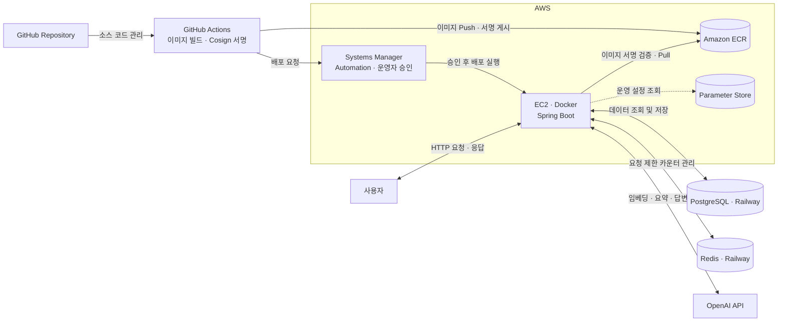
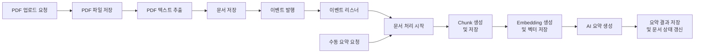

# DocuMind

PDF 문서를 업로드하면 텍스트를 추출하고 AI 요약을 생성합니다. 
또한 사용자는 자연어 질문을 통해 문서 내용을 탐색할 수 있습니다.

## 프로젝트 소개

방대한 PDF 문서를 읽고 필요한 정보를 찾는 데 많은 시간이 소요됩니다.
DocuMind는 PDF 문서를 AI가 이해할 수 있는 형태로 가공하고 사용자가 문서 내용을 빠르게 파악하고 검색할 수 있도록 지원하는 AI 문서 분석 플랫폼입니다.

## 주요 기능

### 회원 기능

* 회원가입 (포트폴리오 배포 버전에서는 비활성화)
* 로그인
* 로그아웃

### 문서 관리

* PDF 파일 업로드
* PDF 텍스트 추출
* 문서 삭제
* 문서 목록 조회
* 문서 페이징
* 문서 상세 조회

### AI 요약

* OpenAI API 기반 문서 요약

### 키워드 검색

* PostgreSQL Full Text Search(FTS) 기반 키워드 검색

### 문서 기반 질의응답

* RAG 기반 질의응답
* Redis 기반 요청 횟수 제한

## 기술 스택

### Backend

* Java 21
* Spring Boot 3.5.14
* Spring Data JPA
* Spring Security

### Database

* PostgreSQL
* Flyway

### Frontend

* Thymeleaf
* Bootstrap

### AI

* OpenAI API
* RestClient

### Build

* Gradle

### Test

* JUnit
* Mockito
* Testcontainers

### DevOps

* AWS
* Docker
* GitHub Actions

## 시스템 아키텍처



## DB 테이블 설계
사용자(User)는 여러 개의 문서(Document)를 업로드할 수 있으며 각 문서는 하나 이상의 AI 처리 결과(DocumentAiResult)를 가질 수 있도록 설계했습니다. 
문서 텍스트를 일정 단위(DocumentChunk)로 분할하여 벡터 검색 및 LLM 컨텍스트 제공에 활용합니다.

### User 테이블
역할: 회원 정보, 인증
|컬럼명|데이터 타입|설명|
|---|---|---|
|id|bigint|아이디(PK)|
|moddate|timestamp without time zone|수정일|
|regdate|timestamp without time zone|등록일|
|email|character varying|로그인 이메일|
|nickname|character varying|닉네임|
|password|character varying|암호화 비밀번호|

### Document 테이블
역할: 업로드 문서 관리
|컬럼명|데이터 타입|설명|
|---|---|---|
|id|bigint|아이디(PK)|
|moddate|timestamp without time zone|수정일|
|regdate|timestamp without time zone|등록일|
|content_type|character varying|문서 종류|
|extracted_text|text|원본 텍스트|
|file_size|bigint|파일 크기|
|original_filename|character varying|원본 파일명|
|status|character varying|문서 처리 상태|
|stored_filename|character varying|저장 파일명|
|user_id|bigint|업로드 사용자(FK)|
|search_vector|TSVECTOR|검색 벡터|

### DocumentAiResult 테이블
역할: AI 처리 결과 관리
|컬럼명|데이터 타입|설명|
|---|---|---|
|id|bigint|아이디(PK)|
|moddate|timestamp without time zone|수정일|
|regdate|timestamp without time zone|등록일|
|content|text|처리 결과|
|model|character varying|AI 모델|
|total_tokens|integer|총 사용 토큰수|
|type|character varying|처리 종류|
|document_id|bigint|처리 대상 문서(FK)|

### DocumentChunk 테이블
역할: 문서 청크 관리
|컬럼명|데이터 타입|설명|
|---|---|---|
|id|bigint|아이디(PK)|
|moddate|timestamp without time zone|수정일|
|regdate|timestamp without time zone|등록일|
|content|text|청크 내용|
|chunk_index|integer|청크 인덱스|
|embedding|vector|임베딩|
|document_id|bigint|처리 대상 문서(FK)|

## 시스템 흐름

### 문서 처리



### 문서 기반 질의응답


## REST API

문서 관련 핵심 기능을 REST API로 제공합니다.

### 전체 API

|메서드|엔드포인트|설명|인증 필요 여부|
|---|---|---|---|
|`POST`|`/api/v1/auth/login`|로그인 API|No|
|`POST`|`/api/v1/document`|PDF 파일 업로드|Yes|
|`DELETE`|`/api/v1/document/{id}`|문서 삭제|Yes|
|`GET`|`/api/v1/document`|문서 목록 조회|Yes|
|`GET`|`/api/v1/document/{id}`|문서 상세 조회|Yes|
|`POST`|`/api/v1/document/{id}/qa`|문서 기반 질의응답|Yes|

### 인증 방식

JWT Bearer 인증 방식을 사용합니다. 인증 흐름은 다음과 같습니다.

```
1. 클라이언트가 로그인 API에 사용자 인증 정보를 전달한다.
2. Spring Security의 인증 절차를 통해 사용자 정보를 검증한다.
3. 인증 성공 시 JWT 액세스 토큰을 발급한다.
4. 클라이언트는 API 요청의 Authorization 헤더에 Bearer 토큰을 전달한다.
5. 서버는 JWT의 유효성을 검증하고 인증 정보를 설정한다.
6. 인증에 성공한 요청만 보호된 API에 접근할 수 있다.
```

### HTTP 상태 코드

|HTTP 상태 코드|설명|
|---|---|
|`200`|요청 성공|
|`201`|요청 성공했으나 응답할 본문이 없음|
|`400`|잘못된 요청|
|`401`|권한 없음|
|`404`|요청한 리소스를 찾을 수 없음|
|`409`|현재 리소스 상태와 요청 간의 충돌|
|`413`|콘텐츠 용량 초과|
|`429`|요청/사용량/동시 처리 한도 초과|
|`500`|내부 서버 오류|

### 문서화

Springdoc OpenAPI를 이용해 API 명세와 Swagger UI 제공합니다.

* Swagger UI: `/swagger-ui.html`
* OpenAPI JSON: `/v3/api-docs`
* OpenAPI YAML: `/v3/api-docs.yaml`

## 구현 과정에서 고려한 점

### AI 문서 요약 구조 설계

* 문서 업로드와 AI 요약 생성을 분리하여 응답 지연을 최소화
* 업로드 완료 후 비동기 이벤트를 통해 요약 작업 수행
* 트랜잭션 커밋 이후에만 요약 작업이 실행되도록 구성하여 데이터 정합성 확보
* AI 처리 시간이 사용자 요청에 영향을 주지 않도록 설계
* 각 계층의 책임을 명확히 분리하여 유지보수성과 확장성을 높임

### 문서 처리 상태 관리

* 문서 처리 과정을 추적하기 위해 상태 기반 구조 적용
* UPLOADED → PROCESSING → COMPLETED / FAILED 흐름으로 관리
* AI 처리 결과를 상태로 표현하여 현재 진행 상황을 확인할 수 있도록 구성
* 실패 상황 발생 시 FAILED 상태로 전환하여 예외 상황을 명확하게 관리
* 처리 상태에 따라 사용자 요청 기반 요약 지원

### 확장성을 고려한 AI 연동 설계

* AI 호출 기능을 비즈니스 로직과 분리하여 결합도를 낮춤
* 향후 다른 AI 모델 또는 서비스로 교체할 수 있도록 구조 설계
* 문서 요약 기능을 기반으로 질의응답, 검색, 임베딩 저장 기능을 확장할 수 있도록 구성
* 기능 추가 시 기존 업로드 및 요약 로직의 변경을 최소화할 수 있도록 설계

### PDF 추출 처리 구조 설계

* DocumentService는 문서 업로드 흐름을 담당
* BatchRunner를 통한 병렬 처리
* PdfTextExtractor는 단일 PDF 추출만 담당
* 저장된 파일 기반 PDF 추출
* PDF 추출 실패 시 업로드를 중단하여 데이터 일관성 보장
* PDF 추출 실패 시 저장된 파일을 일괄 삭제

### 예외 처리

* ErrorCode 기반 예외 처리 구조 적용
* 사용자 친화적인 오류 메시지 제공
* 서비스 계층에서 전달한 예외를 각 진입 경로에서 응답 방식에 맞게 처리하도록 구성
* Web UI는 화면 렌더링과 사용자 피드백에 적합한 방식으로 예외 처리
* REST API는 예외를 HTTP 상태 코드와 JSON 오류 응답으로 변환 

### 입력값 검증

* 회원가입과 문서 업로드 기능에 Bean Validation 적용
* DTO 검증, DB 제약조건, 화면 검증을 함께 구성하여 데이터 무결성 보장
* 검증 로직 누락을 발견한 후 회원가입 검증 테스트 추가
* 사용자에게 즉시 피드백을 제공할 수 있도록 검증 메시지 표시

### 인증 및 세션 처리

* 로그인 이후 사용자 정보가 삭제되는 예외 상황 고려
* UserNotFoundException 발생 시 세션 무효화 및 SecurityContext 정리
* 사용자를 로그인 페이지로 이동시켜 인증 상태를 정상화

### 대용량 파일 업로드 처리

* 파일 크기 초과 시 Tomcat이 연결을 종료하여 예외 응답이 전달되지 않는 문제 확인
* server.tomcat.max-swallow-size=-1 설정 적용
* GlobalExceptionHandler를 통해 업로드 실패 메시지를 사용자에게 정상적으로 전달

### 파일 저장 전략 분리

* 파일 저장 기능을 FileStorage 인터페이스로 추상화
* LocalFileStorage 구현체를 통해 로컬 환경 지원
* 저장 방식 변경 시 비즈니스 로직 수정 없이 확장 가능하도록 설계

### 서비스 계층 리팩토링

* 여러 서비스에서 반복되던 사용자 조회 로직을 UserService로 캡슐화
* 중복 코드 제거를 통해 유지보수성 향상
* 서비스 계층의 책임을 명확하게 분리

### 테스트 전략
* Repository Test를 통한 JPA 쿼리 및 엔티티 매핑 검증
* Service Unit Test를 통한 비즈니스 로직 및 예외 처리 검증
* Mockito를 활용한 외부 의존성 분리
* 테스트 코드의 가독성과 유지보수성을 위해 네이밍 규칙 통일

### 사용자 경험(UX) 개선

* 업로드 실패 시 업로드 모달을 자동으로 다시 표시
* 입력값 변경 시 검증 메시지 제거
* 플래시 메시지 속성을 통일하여 일관된 사용자 피드백 제공
* 문서 상세 화면에서 추출된 텍스트를 바로 확인할 수 있도록 구성
* 업로드 정책 화면 노출
* 문서 목록 화면 반응형으로 카드 UI 분리

### Git 전략

* 기능 단위 브랜치 전략 적용
* feat, fix, refactor 등 목적에 맞는 커밋 메시지 사용

### RAG 설계

* 문서 청킹, 임베딩 생성, 벡터 검색, 검색 결과 기반 답변 생성을 연결하여 단일 문서 RAG 파이프라인 구성
* PostgreSQL의 pgvector를 활용해 기존 데이터베이스 환경에서 벡터 저장과 유사도 검색을 처리
* 환각 완화를 위한 프롬프트 설계
* 요청 제어 로직을 통한 AI API 사용량 관리 및 서비스 안정성 강화

### API 설계

* 기존 Thymeleaf 기반 Web UI와 공존하도록 구성
* 기존 Web 기능에 영향을 최소화하고 API 확장이 가능하도록 구성
* 서비스 계층을 공유하여 비즈니스 로직 중복 방지 및 일관성 보장
* 진입 경로별로 달라지는 책임 분리 및 각 진입 경로에 맞는 보안 정책을 적용

### 배포 보안 및 복구

* 장기 AWS 액세스 키 없이 임시 자격 증명을 사용해 인증 정보 유출 위험 감소
* CI/CD 구성 요소별 권한을 제한해 권한 오용 및 피해 확산 방지
* Cosign 서명 및 digest 검증으로 이미지의 출처와 배포 대상 확인
* 운영자 승인 절차와 환경 변수 분리로 무단 배포 및 정보 노출 위험 완화
* 헬스 체크와 이전 컨테이너 롤백으로 배포 오류에 따른 서비스 중단 최소화

## 트러블슈팅

### 문제
* Railway에서 대용량 PDF 다중 업로드 시 컨테이너 재시작 발생

### 원인 분석
* PDFBox 텍스트 추출 과정에서 리소스 사용량 증가
* Free 플랜의 제한된 메모리 환경 영향

### 대응
* 파일 업로드 검증 강화
* HTTP/2 비활성화
* JVM 메모리 설정 및 실행 환경 개선
* ThreadPool 기반 비동기 처리 도입

### 향후 계획
* Queue 기반 처리
* Redis 도입

## 향후 계획
* AI 답변 품질 개선